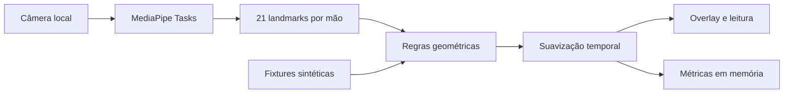

# Visão técnica do projeto

Data de referência: 2026-10-16. Estado: implementação local, sem novo deploy.

## Produto e finalidade

Demo de visão computacional que detecta até duas mãos, conta dedos levantados e nomeia
11 gestos: punho fechado, mão aberta, paz, rock, polegar, indicador, L, três, quatro, OK
e pinça. O público pode observar landmarks, leitura e métricas da própria sessão.
É também uma referência de engenharia para comparar implementações Python e TypeScript.

O MediaPipe fornece landmarks e confiança na lateralidade. A classificação de gestos é
geométrica e explicável; o percentual do modelo não é uma probabilidade de acerto do gesto.
As poses compartilhadas são sintéticas e não constituem um benchmark de acurácia.

## Estrutura e responsabilidades

| Domínio | Implementação | Responsabilidade |
|---|---|---|
| Regras | `web/src/lib/gestures/`, `python/hand_gestures/gestures.py` | Contagem, classificação e suavização |
| Inferência web | `web/src/lib/mediapipe/` | Modelo, WASM, GPU e fallback CPU |
| Inferência desktop | `python/hand_gestures/detector.py` | Adaptar MediaPipe Tasks ao contrato de domínio |
| Asset desktop | `python/hand_gestures/model.py` | Download explícito e integridade do modelo |
| Captura desktop | `python/hand_gestures/camera.py` | Descoberta, aquecimento e configuração |
| Orquestração | `CameraDemo.tsx`, `python/hand_gestures/app.py` | Ciclo de vida e recuperação de falhas |
| Sessão | `web/src/lib/session.ts` | Agregados e timeline em memória |
| Evidência | `fixtures/gestures/`, testes e CI | Contratos e regressões |



## Lógica core

Os dedos indicador, médio, anelar e mínimo usam a posição vertical da ponta em relação
à articulação proximal: pares 8/6, 12/10, 16/14 e 20/18. O polegar compara x de 4/3,
considerando a lateralidade. O vetor de cinco estados seleciona os padrões de gesto.

Pinça usa `distance(4,8) / max(distance(0,9), epsilon) <= 0.35`. Com médio, anelar e
mínimo estendidos, a regra identifica OK; com os três recolhidos, identifica pinça.
Há votação em janela de cinco quadros. Ao perder uma mão, seu histórico é descartado.

O domínio espera coordenadas no referencial selfie. A web converte os resultados do
vídeo cru; o desktop espelha a imagem antes da inferência por padrão. As regras
assumem palma voltada à câmera e mão aproximadamente vertical. Rotação, oclusão,
contraluz e movimento rápido podem causar erros. Não é um reconhecedor de Libras.

## Caminho web

Next.js 16.4.2, React 19.2.8, TypeScript 6.0.3 e Tailwind 4.3.3. As páginas são
pré-renderizadas; não há API, autenticação, upload, banco ou serviço de inferência.
`web/` continua sendo o Root Directory do deploy existente.

O usuário ativa a câmera. O app solicita vídeo sem áudio, baixa o modelo oficial e
inicializa WASM servido pelo próprio site. GPU é tentada primeiro; há fallback CPU
na inicialização e em falha de inferência GPU. O vídeo usa callbacks de quadro quando
disponíveis; canvas atualiza por quadro e a leitura React é limitada a cerca de 10 Hz.

O store da sessão publica a 4 Hz e alimenta `/dashboard`. Dados são mantidos em memória
da aba, sem persistência entre recargas. A distribuição de gestos considera a primeira
mão da leitura; não representa contagem independente de todas as mãos.
O histórico de FPS é limitado a 120 entradas de segundos processados.

Parar e navegar liberam tracks, modelo e loop. Gerações descartam inicializações
assíncronas tardias. Os testes e2e substituem câmera/modelo apenas no build de testes;
o build normal define explicitamente `NEXT_PUBLIC_E2E_STUBS=0`.

## Caminho desktop modernizado

Python 3.12 e MediaPipe Tasks 0.10.35 substituem a API legada `mp.solutions` 0.10.21.
A árvore nova remove Protobuf/JAX em vez de forçar uma versão incompatível do Protobuf.
OpenCV 4.11.0.86 e NumPy 1.26.4 são preservados. As dependências resolvidas estão fixadas
em `python/requirements.txt`; runtime e ferramentas de desenvolvimento continuam separados.

O detector usa modo VIDEO e timestamps estritamente crescentes, mesmo se dois quadros
forem processados no mesmo milissegundo. `close()` é idempotente. `ExitStack` assegura
tentativa de limpeza de todos os recursos mesmo se outro callback de fechamento falhar.
Captura só passa ao chamador depois de aquecimento e configuração bem-sucedidos.

O downloader limita a leitura a 7.819.106 bytes e só aceita exatamente 7.819.105 bytes
com SHA-256 `fbc2a30080c3c557093b5ddfc334698132eb341044ccee322ccf8bcf3607cde1`.
Arquivos temporários são limpos após falha de substituição. O app não busca modelo na rede.

```powershell
cd python
python -m venv .venv
.venv/Scripts/python -m pip install -r requirements.txt
.venv/Scripts/python -m hand_gestures.model
.venv/Scripts/python -m hand_gestures --self-check
.venv/Scripts/python -m hand_gestures
```

## Segurança, privacidade e custo

Frames são processados localmente. A web consulta o Google Cloud Storage para obter o
modelo; o downloader desktop também precisa de rede na preparação. Não foi adicionado
analytics, serviço pago, chave de API, conector remoto ou dependência SaaS.
Os testes do navegador usam vídeo sintético, sem capturar uma câmera física.

A CSP mantém a decisão documentada de scripts inline para páginas estáticas do App Router
e compilação WASM. Ela não equivale a proteção absoluta contra XSS. O hash do modelo foi
adicionado ao desktop; o downloader web ainda não faz a mesma validação de integridade.

O npm ainda reporta a cadeia de desenvolvimento de `braces`; o recorte de produção é
auditado separadamente. Fixar versões não elimina a necessidade de revisão periódica.
Código open-source e inferência local evitam custo por requisição, mas não garantem
hospedagem e tráfego gratuitos para qualquer uso comercial ou escala.

## Evidência e limites

A validação Python após a mudança inclui 68 testes, Ruff, formatação, mypy, auditoria
dos pins e smoke real com quadro vazio. A cobertura total de 85% agora inclui detector
e modelo; o relatório inicial de 61% excluía o detector e tinha outro denominador.
As regras continuam com 99% de cobertura. Nenhum desses números mede acurácia visual.

Resultados finais da web e limitações de publicação ficam em `ROADMAP_AND_SKILLS.md`.
Validação com mão real, revisão visual manual e execução do CI remoto continuam distintas
dos checks locais. Veja também `docs/ARCHITECTURE.md` e ADR 0005.
