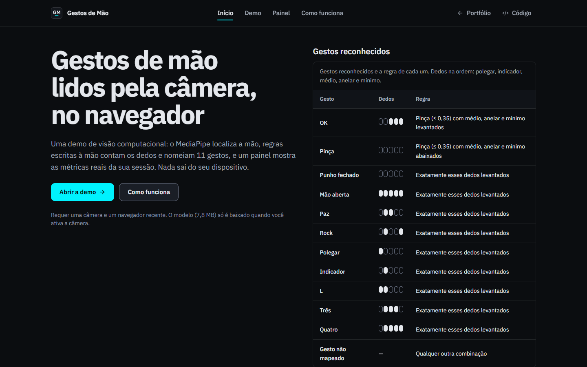

# Reconhecimento de Gestos de Mão

Demo de visão computacional que reconhece gestos de mão pela câmera, direto no navegador. O MediaPipe Hand Landmarker localiza 21 pontos de cada mão; regras explicáveis contam os dedos levantados e nomeiam 11 gestos; um painel mostra as métricas reais da sessão. O vídeo não sai do dispositivo.

[](https://www.matheussiqueira.dev/pt-BR/projects/hand-gesture-recognition-realtime)
[](https://github.com/matheussiqueira-dev/Reconhecimento-de-Gestos-de-Mao)

<sub>Design system compartilhado ms-tokens v1.0 · IBM Plex Sans · WCAG 2.2 AA</sub>

O repositório tem duas implementações das mesmas regras:

- **`web/`**: o site (Next.js 16, TypeScript, Tailwind CSS 4), publicado na Vercel;
- **`python/`**: o app desktop original (Python 3.12, OpenCV, MediaPipe), com HUD e seleção de câmera.

As duas passam pelos mesmos casos de teste sintéticos em `fixtures/gestures/`.



## Funcionalidades

- Câmera ativada só depois do clique, com estados próprios para permissão negada, câmera ausente ou em uso, contexto inseguro e falha ao carregar o modelo.
- Até duas mãos por quadro, com overlay dos 21 pontos, gesto, dedos levantados e a confiança do modelo na lateralidade.
- Gestos: Punho fechado, Mão aberta, Paz, Rock, Polegar, Indicador, L, Três, Quatro, OK e Pinça (as regras estão em [`web/src/lib/gestures/analyze.ts`](web/src/lib/gestures/analyze.ts)).
- Suavização por maioria em 5 quadros; sem mão no quadro, a tela mostra "Nenhuma mão detectada".
- Painel da sessão com tempo de câmera, quadros processados, quadros por segundo, inferência média, distribuição de gestos e linha do tempo, cada gráfico com tabela alternativa.
- Dark-only, IBM Plex Sans, tokens `ms-tokens.css` v1.0 compartilhados com o portfólio.

## Arquitetura

```
.
├── web/                 Next.js App Router, só páginas estáticas (nenhuma Function)
│   ├── src/lib/gestures      regras, suavização e conversão para o quadro selfie
│   ├── src/lib/mediapipe     carregamento do modelo e do runtime WASM
│   ├── src/components/demo   câmera, overlay e leitura
│   └── tests/{unit,e2e}      Vitest e Playwright + axe
├── python/              app desktop (hand_gestures/) e seus testes
├── fixtures/gestures/   poses sintéticas com o resultado esperado, usadas pelos dois lados
├── tools/brand/         gerador do monograma, ícones e imagem OG
└── docs/                ADRs, privacidade, segurança, capturas
```

Fluxo no navegador: `getUserMedia` → `HandLandmarker.detectForVideo` (MediaPipe Tasks Vision 0.10.35, WebAssembly servido pelo próprio site, GPU com fallback para CPU) → conversão para o quadro selfie → regras → suavização → overlay em canvas e leitura a ~10 Hz. Detalhes e decisões em [docs/ARCHITECTURE.md](docs/ARCHITECTURE.md) e [docs/adr/](docs/adr/).

## Rodar a versão web

Requer Node.js 24 (veja `web/.nvmrc`) e npm.

```bash
cd web
npm ci
npm run dev
```

`npm run dev` e `npm run build` copiam antes o runtime WASM do MediaPipe de `node_modules` para `public/mediapipe/<versão>/` (pasta ignorada pelo Git).

| Script | O que faz |
|---|---|
| `npm run lint` | ESLint (config do Next), sem avisos |
| `npm run typecheck` | `next typegen && tsc --noEmit` (funciona num clone limpo) |
| `npm test` | Vitest: regras contra as fixtures, versão do MediaPipe, hash dos tokens |
| `npm run build` | build de produção; todas as rotas estáticas |
| `npm run test:e2e` | Playwright + axe; faz um build com `NEXT_PUBLIC_E2E_STUBS=1` e sobe na porta 3200 |

O e2e usa o Microsoft Edge instalado (`PLAYWRIGHT_CHANNEL=msedge`, padrão local). No CI, `PLAYWRIGHT_CHANNEL=chromium`. Um dos testes carrega o modelo real e precisa de acesso a `storage.googleapis.com`.

## Rodar a versão Python

Requer Python 3.12 (o `mediapipe` 0.10.21, última versão com a API `mp.solutions`, não tem wheel para 3.13).

```bash
cd python
python -m venv .venv
.venv/Scripts/activate        # Windows; no Linux/macOS: source .venv/bin/activate
pip install -r requirements.txt
python -m hand_gestures --help
python -m hand_gestures                      # primeira câmera que funcionar
python -m hand_gestures --camera-name "Brio" # por nome (Windows, requer pip install pygrabber==0.2)
python -m hand_gestures --self-check         # testa o MediaPipe sem câmera
```

Teclas na janela: `q` sai, `l` liga/desliga os pontos, `h` liga/desliga o HUD.

Testes e checagens (não precisam do OpenCV nem do MediaPipe):

```bash
cd python
pip install -r requirements-dev.txt
sh scripts/check.sh   # ruff, formatação, mypy estrito e pytest com cobertura
```

## Deploy na Vercel

Um projeto, só o app web, sem Functions nem variáveis obrigatórias.

| Configuração | Valor |
|---|---|
| Root Directory | `web` |
| Framework Preset | Next.js (fixado em `web/vercel.json`) |
| Install / Build | padrão do preset (`npm ci` / `npm run build`) |
| Node.js | 24.x (`engines` do `web/package.json`) |

O projeto `reconhecimento-de-mao` já existe na Vercel; para publicar, ajuste o Root Directory para `web` e faça o merge na `main`. O `.vercelignore` da raiz deixa `python/`, `tools/` e `fixtures/` fora de uploads pela CLI.

### Variáveis de ambiente

| Nome | Escopo | Obrigatória | Uso |
|---|---|---|---|
| `NEXT_PUBLIC_SITE_URL` | Production, Preview | Não | Origem absoluta para canonical, Open Graph e sitemap. Padrão: `VERCEL_PROJECT_PRODUCTION_URL` e, sem ela, `https://reconhecimento-de-mao.vercel.app` |
| `NEXT_PUBLIC_E2E_STUBS` | nenhum | Não | Só para o build de e2e. Nunca configure na Vercel |

`VERCEL_PROJECT_PRODUCTION_URL` e `VERCEL_GIT_COMMIT_SHA` (versão no rodapé) são variáveis de sistema da Vercel. Veja `web/.env.example`.

## Privacidade

- Nenhum quadro, imagem ou ponto da mão é enviado. A inferência roda no navegador.
- Ao ativar a câmera, o navegador baixa o modelo Hand Landmarker (7,8 MB, Apache-2.0) do Google Cloud Storage; é a única requisição a terceiros.
- Sem analytics, cookies ou cadastro. Métricas da sessão ficam na memória da aba; preferências (espelhar, mostrar pontos) no `localStorage`.

Detalhes em [docs/PRIVACY.md](docs/PRIVACY.md). Segurança (CSP, headers, dependências) em [docs/SECURITY.md](docs/SECURITY.md).

## Limitações

- As regras assumem a mão em pé com a palma voltada para a câmera; mão deitada, de costas ou com dedos sobrepostos engana a contagem.
- Pouca luz e contraluz reduzem a detecção.
- Um punho com a ponta do polegar encostada na do indicador pode ser lido como Pinça.
- O e2e verifica a interface com poses sintéticas e o carregamento do modelo real com uma câmera sintética; o reconhecimento com uma mão de verdade é verificado manualmente.
- Não serve para identificação, autenticação nem uso clínico.

## Licença

MIT. Veja [LICENSE](LICENSE). O modelo Hand Landmarker e o MediaPipe são Apache-2.0; a IBM Plex Sans é OFL-1.1.

---

### Desenvolvido por Matheus Siqueira

**Analista de Dados & BI | Power BI • SQL • Python • DAX | ETL, Modelagem de Dados, KPIs e Automação**

Conecte-se e acesse meus projetos:

[](https://www.matheussiqueira.dev)
[](https://www.linkedin.com/in/matheussiqueira-dev)
[](https://github.com/matheussiqueira-dev)
[](mailto:hellomatheusdev@gmail.com)
